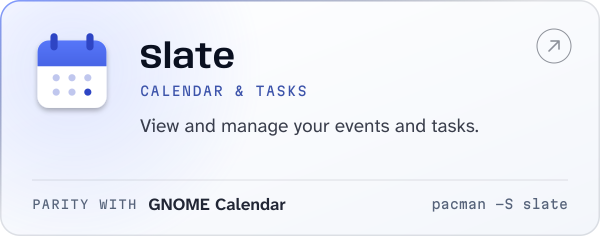
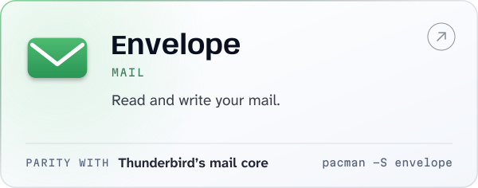
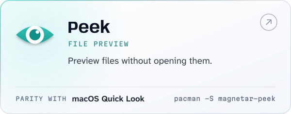
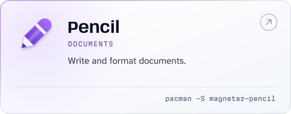
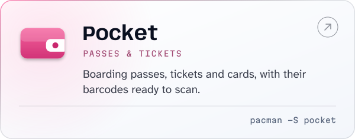
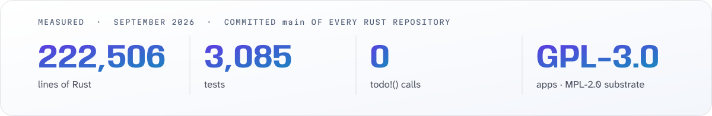

<div align="center">



<br><br>

<a href="https://magnetaros.com"></a>&nbsp;
<a href="#install"><picture><source media="(prefers-color-scheme: dark)" srcset="https://raw.githubusercontent.com/Magnetar-OS/.github/main/profile/assets/pill-install-dark.svg"></picture></a>&nbsp;
<a href="https://github.com/orgs/Magnetar-OS/repositories"><picture><source media="(prefers-color-scheme: dark)" srcset="https://raw.githubusercontent.com/Magnetar-OS/.github/main/profile/assets/pill-repos-dark.svg"></picture></a>

</div>

<br>

CachyOS ships one desktop edition, and it is Plasma. Magnetar is the COSMIC one: CachyOS’s kernel, hardware
detection and optimised packages, System76’s Rust desktop on top, and a suite of apps written for it that
exist nowhere else.

## The suite

Every app is held to a named rival, sits on one shared substrate for storage, sync and credentials, and
ships as its own package in the signed `[magnetar]` repository. Take all of them or only the ones you want.

<p align="center">
<a href="https://github.com/Magnetar-OS/slate"><picture><source media="(prefers-color-scheme: dark)" srcset="https://raw.githubusercontent.com/Magnetar-OS/.github/main/profile/assets/card-slate-dark.svg"></picture></a>
<a href="https://github.com/Magnetar-OS/envelope"><picture><source media="(prefers-color-scheme: dark)" srcset="https://raw.githubusercontent.com/Magnetar-OS/.github/main/profile/assets/card-envelope-dark.svg"></picture></a>
<a href="https://github.com/Magnetar-OS/circle"><picture><source media="(prefers-color-scheme: dark)" srcset="https://raw.githubusercontent.com/Magnetar-OS/.github/main/profile/assets/card-circle-dark.svg"></picture></a>
<a href="https://github.com/Magnetar-OS/locket"><picture><source media="(prefers-color-scheme: dark)" srcset="https://raw.githubusercontent.com/Magnetar-OS/.github/main/profile/assets/card-locket-dark.svg"></picture></a>
<a href="https://github.com/Magnetar-OS/jump"><picture><source media="(prefers-color-scheme: dark)" srcset="https://raw.githubusercontent.com/Magnetar-OS/.github/main/profile/assets/card-jump-dark.svg"></picture></a>
<a href="https://github.com/Magnetar-OS/peek"><picture><source media="(prefers-color-scheme: dark)" srcset="https://raw.githubusercontent.com/Magnetar-OS/.github/main/profile/assets/card-peek-dark.svg"></picture></a>
<a href="https://github.com/Magnetar-OS/pencil"><picture><source media="(prefers-color-scheme: dark)" srcset="https://raw.githubusercontent.com/Magnetar-OS/.github/main/profile/assets/card-pencil-dark.svg"></picture></a>
<a href="https://github.com/Magnetar-OS/pocket"><picture><source media="(prefers-color-scheme: dark)" srcset="https://raw.githubusercontent.com/Magnetar-OS/.github/main/profile/assets/card-pocket-dark.svg"></picture></a>
</p>

## Underneath

| | Repository | What it is |
|---|---|---|
| Library | [**cosmic‑pim**](https://github.com/Magnetar-OS/cosmic-pim) | The substrate under Slate, Circle and Envelope: storage, sync, credentials, iCalendar and vCard. A sync bug is fixed once, not three times. |
| Library | [**cosmic‑ext‑nib**](https://github.com/Magnetar-OS/cosmic-ext-nib) | Nib, a rich text engine with no web engine in the pipeline. Envelope’s composer and all of Pencil. |
| Library | [**cosmic‑ext‑widgets**](https://github.com/Magnetar-OS/cosmic-ext-widgets) | Widgets libcosmic does not have, such as a sidebar that collapses to a rail. |
| App | [**magnetar‑accounts**](https://github.com/Magnetar-OS/magnetar-accounts) | Online accounts. Add mail, calendar and contacts once — by address, browser sign-in or GNOME Online Accounts — and Envelope, Slate and Circle all use them. |
| App | [**grabit**](https://github.com/Magnetar-OS/grabit) | Select text anywhere and get a small bar of actions over it: copy, search, translate, transform, run. Wayland only. |
| Distribution | [**magnetar**](https://github.com/Magnetar-OS/magnetar) | The live ISO (an overlay on CachyOS’s, not a fork), the PKGBUILDs, and the meta package that turns a CachyOS install into Magnetar. |
| Distribution | [**arch‑repo**](https://github.com/Magnetar-OS/arch-repo) | The signed pacman repository, served from [repo.magnetaros.com](https://repo.magnetaros.com). |
| Distribution | [**magnetar‑web**](https://github.com/Magnetar-OS/magnetar-web) | The source of [magnetaros.com](https://magnetaros.com). |
| Hardware | [**logitech‑bolt‑hidpp‑dkms**](https://github.com/Magnetar-OS/logitech-bolt-hidpp-dkms) | Hi-res wheel diversion on Logitech Bolt receivers — the MX Master 4 scroll fix — built by DKMS. |
| Hardware | [**audient‑id24‑dkms**](https://github.com/Magnetar-OS/audient-id24-dkms) | The Audient iD24 on Linux: a mixer map for snd-usb-audio, built by DKMS, and a UCM profile. |

## How it’s built

<picture><source media="(prefers-color-scheme: dark)" srcset="https://raw.githubusercontent.com/Magnetar-OS/.github/main/profile/assets/layers-dark.svg"></picture>

<table>
<tr>
<td width="50%" valign="top"><b>Complete against a named rival</b><br>Every app covers everything its benchmark does. The parity table in its roadmap is the scoreboard.</td>
<td width="50%" valign="top"><b>Fixed once, below the interface</b><br>A shared substrate owns storage, sync and credentials, so a bug is fixed in one place and every app stays a thin front end.</td>
</tr>
<tr>
<td valign="top"><b>Nothing siloed</b><br>Panel applets, launcher plugins, daemons, portals and shared settings. The apps talk to the desktop and to each other.</td>
<td valign="top"><b>Wayland and the GPU, no apologies</b><br>Layer-shell surfaces where they fit, and wgpu as the one rendering path that gets tuned.</td>
</tr>
</table>

<picture><source media="(prefers-color-scheme: dark)" srcset="https://raw.githubusercontent.com/Magnetar-OS/.github/main/profile/assets/stats-dark.svg"></picture>

## Install

> [!NOTE]
> **Pre-release.** The live ISO is not published yet, and the package repository is still being filled.

Already running CachyOS? Three steps turn it into Magnetar.

**1 · Trust the signing key.** Confirm the fingerprint before you sign it:
`382D 9848 41F8 C8A2 BFB9  5267 5623 FAF3 DF36 FFAF` — Magnetar OS (package signing) &lt;packages@magnetaros.com&gt;

```sh
curl -sLo /tmp/magnetar.asc https://repo.magnetaros.com/magnetar.asc
sudo pacman-key --add /tmp/magnetar.asc
sudo pacman-key --lsign-key 382D984841F8C8A2BFB952675623FAF3DF36FFAF
```

**2 · Add the repository** to `/etc/pacman.conf`, above the `[cachyos]` section — pacman takes each package
from the first repository that has it. Keep the signature level as written.

```ini
[magnetar]
SigLevel = Required DatabaseOptional
Server = https://repo.magnetaros.com/$arch
```

**3 · Install.** One meta package brings in COSMIC with Magnetar’s defaults and branding. The apps are
packages of their own, so drop any you don’t want from the last line.

```sh
sudo pacman -Syu
sudo pacman -S magnetar-desktop
sudo pacman -S slate envelope circle locket jump magnetar-peek magnetar-pencil pocket
```

<br>

<div align="center">
<a href="https://magnetaros.com"></a>
<br>
<sub>Apps GPL-3.0 · substrate MPL-2.0 · art CC BY-SA 4.0 · <a href="https://magnetaros.com">magnetaros.com</a></sub>
</div>
